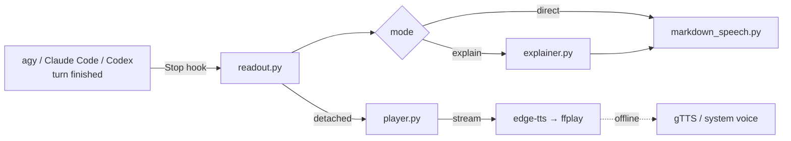

# Voice Readout

[](https://github.com/Robinaditya1045/readout-plugin/actions/workflows/tests.yml)
[](LICENSE)


**Hear your coding agent's answers.** Voice Readout speaks each finished response from **Google Antigravity CLI (`agy`)**, **Claude Code** or **OpenAI Codex CLI** in a natural neural voice. It doesn't read markdown symbols out loud. It explains the answer the way a colleague would and reads out every command you need to run.

- 🧠 **Explains, doesn't just read:** you get the takeaway, the steps in order, the options, warnings, and the question the agent is asking you.
- ⌨️ **Every command, spoken naturally:** `rm -rf node_modules && npm ci` becomes "rm -rf node_modules, and then npm ci".
- ⚡ **Starts in about a second:** audio streams while it is being synthesized and plays in the background, so your terminal never waits.
- 🎛️ **Instant control:** `/readout stop`, `replay`, `off`, `mode` and `voice` run without spending a model turn.
- 🔌 **One install, three agents:** a single config and a single player, shared by every agent you use.

---

## Table of contents

- [What it sounds like](#what-it-sounds-like)
- [Supported agents](#supported-agents)
- [Installation](#installation)
- [Usage](#usage)
- [Configuration](#configuration)
- [How it works](#how-it-works)
- [Privacy](#privacy)
- [Troubleshooting](#troubleshooting)
- [Uninstall](#uninstall)
- [Development](#development)
- [Contributing](#contributing)
- [License](#license)

---

## What it sounds like

Given this agent response:

````markdown
The build failed because `node_modules` is out of date after the lockfile changed in the last merge, so the installed packages no longer match what the code expects.

### Step 1: Reinstall dependencies
Remove the stale install first, then install exactly what the lockfile pins:
```bash
rm -rf node_modules
npm ci
```

### Step 2: Run the tests
```bash
npm test -- --coverage
```

> [!WARNING]
> `npm ci` deletes any packages you installed by hand.

Want me to fix the failing snapshot test too?
````

**`explain` mode** (default) says:

> The build failed because node_modules is out of date after the lockfile changed in the last merge, so the installed packages no longer match what the code expects. There are 2 steps. Step 1: Reinstall dependencies: Remove the stale install first, then install exactly what the lockfile pins: run rm -rf node_modules; then npm ci. Step 2: Run the tests: Run: npm test -- --coverage. Warning: npm ci deletes any packages you installed by hand. Want me to fix the failing snapshot test too?

**`direct` mode** reads everything word for word, with markdown stripped and code replaced by a short notice:

> The build failed because node_modules is out of date … Step 1: Reinstall dependencies. Remove the stale install first, then install exactly what the lockfile pins: Shell code block omitted. Step 2: Run the tests. Shell code block omitted. Warning: npm ci deletes any packages you installed by hand. Want me to fix the failing snapshot test too?

Explain mode handles the shapes agents actually produce:
- **Short replies** are read in full.
- **Step-by-step guides and option lists** are read in order ("There are 3 options…").
- **Change reports** are summarized from their item titles.
- **Status tables** are read as key/value pairs; wide tables are summarized.
- **Console transcripts, comments, heredocs and test logs** inside code blocks are skipped.
- **Code snippets** are described ("there's a Python snippet for app.py on screen").
- **Long responses** are kept to about 1,000 characters of prose. Commands and warnings are never dropped, and skipped sections are named ("It also covers…").

---

## Supported agents

| Agent | How responses are spoken | How `/readout` works in the agent |
|---|---|---|
| **Antigravity CLI (`agy`)** | `Stop` hook reads the final message from the session transcript | `PreInvocation` hook runs it before the model and injects the result |
| **Claude Code** | `Stop` hook receives `last_assistant_message` | `UserPromptExpansion` hook runs `/voice-readout:readout …` and blocks it, so no model turn is used |
| **Codex CLI** | `Stop` hook in `~/.codex/hooks.json` receives `last_assistant_message` | Use the `readout` command in a shell |

Tested with agy, Claude Code 2.1.296 and Codex CLI 0.152.0 on Linux. The code handles macOS (`say`) and Windows (PowerShell) for the offline fallback voice, but those platforms aren't regularly tested yet.

---

## Installation

### Requirements

- **Python 3.10+**
- **Neural voices:** `python3 -m pip install --user -r requirements.txt` (installs [`edge-tts`](https://github.com/rany2/edge-tts) and [`gTTS`](https://github.com/pndurette/gTTS)).
- **An audio player:** `ffplay` (part of ffmpeg), `mpv` or `cvlc`.
  - Debian/Ubuntu: `sudo apt install ffmpeg`
  - macOS: `brew install ffmpeg`
- Without these it still works, falling back to your system's built-in voice (`spd-say` on Linux, `say` on macOS).

### Quick install (all agents)

```bash
git clone https://github.com/Robinaditya1045/readout-plugin.git
cd readout-plugin
python3 -m pip install --user -r requirements.txt
./install.sh               # installs for every supported agent it finds
./install.sh claude codex  # …or only the agents you name
```

`install.sh` installs the shared runtime to `~/.local/share/voice-readout`, links the `readout` command into `~/.local/bin`, sets up each agent, and warns about anything missing. Re-run it after `git pull` to update. Then check your audio with:

```bash
readout test
```

### Per-agent details

<details>
<summary><b>Claude Code</b></summary>

Install straight from GitHub inside Claude Code (v2.1.275 or later):

```text
/plugin install voice-readout --marketplace Robinaditya1045/readout-plugin
```

Or add the marketplace first, then install:

```text
/plugin marketplace add Robinaditya1045/readout-plugin
/plugin install voice-readout@voice-readout
```

`./install.sh claude` does the same from your clone. It adds the clone as a local marketplace, so Claude Code loads the plugin in place and your edits take effect after `/reload-plugins`. The plugin includes the `readout` command on the PATH of Claude's Bash tool.

</details>

<details>
<summary><b>Codex CLI</b></summary>

```bash
./install.sh codex
```

This adds a `Stop` hook to `~/.codex/hooks.json` (or `$CODEX_HOME/hooks.json`) and keeps any hooks you already have. **Codex skips new hooks until you trust them:** open Codex, run `/hooks`, and trust the voice-readout hook once.

On older Codex versions without hooks, use `notify` in `~/.codex/config.toml` instead, with an absolute path:

```toml
notify = ["python3", "/home/you/.local/share/voice-readout/scripts/readout.py"]
```

Use either the hook or `notify`, not both, or every response is spoken twice.

</details>

<details>
<summary><b>Antigravity CLI (agy)</b></summary>

```bash
./install.sh agy
```

This copies the plugin into `~/.gemini/config/plugins/voice-readout`. agy runs that copy, so re-run the installer after changing the repo. Restart agy to reload commands and skills; hook scripts update on the next turn.

</details>

---

## Usage

### The `readout` command

Works from any terminal, and inside agy as `!readout …`:

| Command | What it does |
|---|---|
| `readout on` / `readout off` | Turn readout on or off. `off` also stops any speech in progress |
| `readout stop` | Stop the current speech; readout stays on |
| `readout replay` | Read the last response again |
| `readout mode explain` / `readout mode direct` | Conversational brief, or word-for-word |
| `readout voice <name>` | Change the voice (see below) |
| `readout status` | Show the current settings |
| `readout test` | Speak a sample |

### Inside your agent

- **agy:** `/readout stop`, `/readout replay`, `/readout mode direct`, …
- **Claude Code:** `/voice-readout:readout stop`, and the same for every other action. These are handled by a hook in milliseconds and never reach the model.
- **Codex:** run `readout …` in a shell.

After `/readout stop`, `replay` or `test`, the agent's short confirmation is not read aloud, so it never talks over or cuts off what you asked for.

### Voices

| Name | Voice |
|---|---|
| `siri` / `ava` (default) | `en-US-AvaNeural`: natural, modern assistant |
| `emma` | `en-US-EmmaNeural`: warm, conversational |
| `aria` | `en-US-AriaNeural`: expressive |
| `jenny` | `en-US-JennyNeural`: clear |
| `andrew` | `en-US-AndrewNeural`: natural, conversational |
| `brian` | `en-US-BrianNeural`: professional |
| `guy` | `en-US-GuyNeural`: casual |
| `google` | Google Translate voice (gTTS) |

Any other [edge-tts voice](https://github.com/rany2/edge-tts#changing-the-voice) name works too, e.g. `readout voice en-GB-SoniaNeural`.

---

## Configuration

Settings live in `~/.config/voice-readout/config.json`, shared by all agents. The `readout` command edits them for you. Set `VOICE_READOUT_HOME` to use another directory. Settings from versions before 2.0 (`~/.gemini/antigravity-cli/voice_readout_config.json`) are picked up automatically.

| Key | Default | Description |
|---|---|---|
| `enabled` | `true` | Speak responses at all |
| `mode` | `"explain"` | `"explain"` (conversational brief) or `"direct"` (verbatim) |
| `voice` | `"en-US-AvaNeural"` | Voice name or alias |
| `speech_rate` | `"+0%"` | Speed, e.g. `"+15%"` or `"-10%"` |
| `explain_max_chars` | `1000` | Soft limit on spoken prose in explain mode. Commands and warnings are always read |
| `max_chars` | `2000` | Hard limit for direct mode |
| `include_code_notice` | `true` | Say "code block omitted" in direct mode |
| `use_llm` | `false` | Let Gemini 2.5 Flash write the explain-mode summary (needs `gemini_api_key` or `GEMINI_API_KEY`). Falls back to the built-in explainer on any error |

---

## How it works



1. When a turn ends, the agent's `Stop` hook runs `scripts/readout.py`, which works out which agent called it and gets the final response.
2. `markdown_speech.py` parses the markdown into headings, paragraphs, lists, code, tables and callouts. `explainer.py` builds the spoken brief from that structure.
3. The text goes to `player.py` in a separate background process, so the hook returns immediately. The player stops any speech already playing, then streams edge-tts audio into ffplay as it arrives.
4. `/readout` commands are caught by a hook before the model runs (agy `PreInvocation`, Claude Code `UserPromptExpansion`).

---

## Privacy

To produce neural voices, the spoken text is sent to an online text-to-speech service:
- **Microsoft Edge TTS**, through `edge-tts`.
- **Google Translate TTS**, through `gTTS`, when you use the `google` voice or edge-tts is unavailable.
- **Gemini**, but only when you turn on `use_llm`.

If none of these are reachable, the system voice is used and nothing leaves your machine. Use `readout off` for sessions that involve sensitive material.

---

## Troubleshooting

| Problem | Fix |
|---|---|
| No sound at all | Run `readout status` (is it enabled?), then `readout test`. Re-run `./install.sh`; it reports missing packages and players |
| Robotic voice | edge-tts/gTTS are missing or you're offline. Run `python3 -m pip install --user -r requirements.txt` |
| Codex never speaks | Run `/hooks` in Codex and trust the voice-readout hook |
| Claude Code never speaks | Check `claude plugin list` shows `voice-readout` enabled, then `/reload-plugins` |
| agy uses old behaviour | Re-run `./install.sh agy`; agy runs its own copy of the plugin |
| Two voices at once | You enabled both the Codex hook and `notify`; keep one |
| `readout: command not found` | Add `~/.local/bin` to your `PATH` |

`/readout` handling is logged to `~/.config/voice-readout/hook.log`.

---

## Uninstall

```bash
./install.sh uninstall          # every agent, plus the runtime and the readout command
./install.sh uninstall codex    # just one agent
```

Your settings in `~/.config/voice-readout` are kept; delete that folder to remove them too. From inside Claude Code you can also run `/plugin uninstall voice-readout@voice-readout`.

---

## Development

```bash
python3 -m unittest discover tests                 # all tests (nothing is played out loud)
python3 -m unittest tests.test_explainer           # one module
claude plugin validate . && agy plugin validate .  # check both plugin manifests
```

Try explain mode on any markdown file:

```bash
python3 -c "import sys; sys.path.insert(0, 'scripts'); from explainer import explain_response; print(explain_response(open('reply.md').read()))"
```

To run the real player silently, set `SDL_AUDIODRIVER=dummy`. Use `VOICE_READOUT_HOME=/tmp/vr` to keep test runs away from your settings.

<details>
<summary>Project layout</summary>

```
├── .claude-plugin/          # Claude Code manifest and marketplace
├── hooks/hooks.json         # Claude Code hooks (Stop, UserPromptExpansion)
├── plugin.json, hooks.json  # agy manifest and hooks (PreInvocation, Stop)
├── commands/, skills/       # /readout command and skill (shared)
├── bin/readout              # `readout` on Claude Code's Bash PATH
├── install.sh               # install, update and uninstall for every agent
├── scripts/
│   ├── readout.py           # Stop hook: detect agent, pick mode, start the player
│   ├── pre_hook.py          # instant /readout handling (agy, Claude Code)
│   ├── explainer.py         # explain mode
│   ├── markdown_speech.py   # markdown parser and speech cleanup
│   ├── player.py            # streaming TTS playback, stop, fallback voices
│   ├── toggle.py            # the `readout` command
│   └── state.py             # config and runtime state paths
└── tests/
```

</details>

---

## Contributing

Issues and pull requests are welcome. See [CONTRIBUTING.md](CONTRIBUTING.md) for the development setup and guidelines, and [CHANGELOG.md](CHANGELOG.md) for release history.

## License

[MIT](LICENSE)
